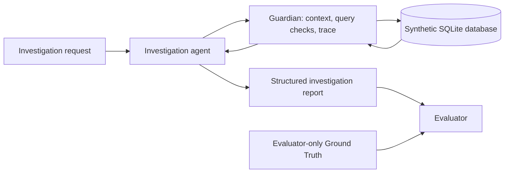

# Database Guardians

**An experimental governance and investigation layer for AI agents working with relational data.**

Database Guardians explores how structured database context, constrained query access, and investigation traces can help an AI agent investigate a data discrepancy. The current research example is a synthetic financial reconciliation case.

> **Project status:** this public repository is a documentation showcase. It does not distribute the local prototype or provide a runnable demonstration. The prototype and its supporting artifacts remain under review.

## Problem

An agent investigating a database may spend steps rediscovering tables and relationships, issue invalid or repetitive queries, or produce conclusions that are hard to audit. In financial operations, an investigation should connect its conclusion to observed records and preserve a trace of the queries used.

Database Guardians studies a possible governance boundary that can provide relevant schema context, validate or constrain query requests, record investigation events, and support post-run evaluation. These are prototype and research goals, not claims of production readiness.

## Research architecture

The local experimental prototype contains separate agent, database adapter, Guardian, evaluator, and scenario-runner modules. It uses SQLite and synthetic records for functional experiments. Ground Truth is intended for evaluation after an investigation and must remain outside the agent-visible surface.

## Current evidence

A local result artifact records one run of SCN_IR_001 using qwen2.5-coder:3b through Ollama. In that artifact, condition A records 8 queries and does not identify the root cause; condition B records 2 queries and identifies the expected cause and impact. Evidence F1 for B is 0.60.

This is a descriptive result from one synthetic scenario and one recorded run. The arithmetic difference is 75% fewer recorded queries in B for that run. It is not evidence of cost or latency reduction, production safety, statistical significance, or general effectiveness. The conditions also differ in semantic guidance, so the result does not isolate the Guardian’s individual mechanisms. The run has not been reproduced for this public showcase.

Earlier benchmark entries are not included because their provenance has not yet been reconciled with a specific run and code revision.

## What is implemented and what is not

- **Present in the local research workspace:** a synthetic SQLite schema and scenario, agent/provider interface, Guardian adapter, evaluator, benchmark runner, and saved result artifact.
- **Included in this public repository:** documentation and the existing license only.
- **Not established by current evidence:** general effectiveness, production database load protection, enterprise integrations, multi-database support, statistical significance, or commercial readiness.
- **Not included in this showcase:** local engine, raw run traces, database files, evaluator Ground Truth, credentials, and integration configuration.

## Reproducibility and next research steps

The public repository is not runnable. A future reproducible release would need a reviewed synthetic package that separates agent-visible scenario data from evaluator-only Ground Truth, a pinned code/configuration revision, model and prompt metadata, execution instructions, and a reconciled evaluation report. The existing seed file exposes expected and configured tax rates together and must not be published unchanged as an agent-facing scenario.

The next research step is to reconcile experiment conditions and benchmark provenance, then evaluate multiple blinded synthetic cases with equivalent budgets and explicit query, evidence, and latency definitions. SQLite results should not be generalized to production OLTP behavior.

## Publication and licensing status

The repository already contains a LICENSE file with the MIT License text. This proposed README update does not change that file and does not publish or offer the local prototype. The licensing and ownership status of materials outside this repository are not addressed here. No decision has been made about a future open-source, open-core, or proprietary product model.

## Repository contents

- README.md — public project overview and research status.
- LICENSE — existing MIT license for repository contents.